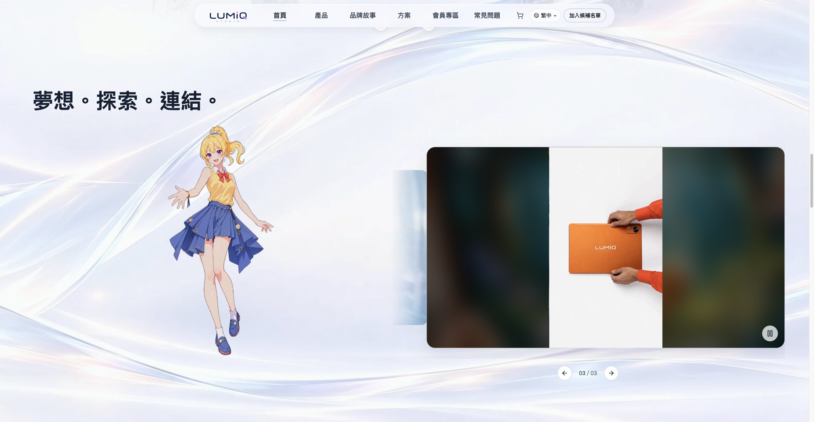
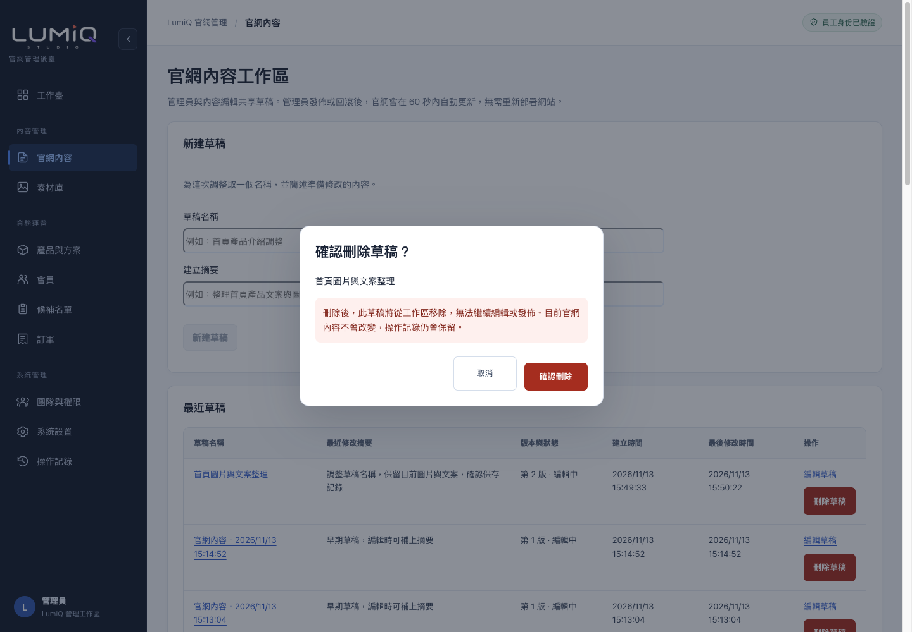
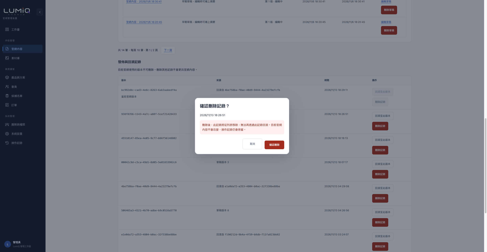

# 官網內容同步與後臺記錄管理核驗

核驗日期：2026 年 11 月 13 日。報告中的畫面與數據來自本輪實際操作。

[Open deployed site — 管理後臺](https://lumiq-admin-cccircccle-s-projects.vercel.app/content) · [Open deployed site — 官網](https://lumiq-parallax-collab-public.vercel.app/zh-hant)

## 結果

一般文字、圖片與影片已完成「上傳或修改 → 保存草稿 → 私有預覽 → 管理員發佈 → 官網更新 → 回滾」核驗。內容更新期間沒有重新部署 Vercel。已開啟的官網頁面會檢查新版本並自動更新；本次觀測到發佈後約 **7.8 秒**顯示新文字。這是單次實測，日常更新提示仍按 **60 秒內**說明。

最近草稿與發佈／回滾記錄各自每頁顯示 10 筆，可獨立翻頁。管理員可刪除草稿與非當前版本的記錄，刪除前會要求確認。當前官網使用中的版本不可刪除，操作記錄仍會保留。

本輪已還原原有官網內容，保留協作者的最新開場、捲動及卡片修改。新增程式或變更版型仍需要部署；日常修改已有內容欄位不需要部署。

## 需求與實際結果

| 項目 | 操作與結果 |
| --- | --- |
| 文字替換 | 保存草稿後重新讀取，繁體首頁標題帶入本輪的排版空格；點擊「發佈當前版本」，同一個已開啟的官網頁面自動顯示新值。回滾後恢復原值。 |
| 圖片替換 | 透過素材庫實際上傳原有圖片副本，完成服務端校驗，寫入對應草稿位置。私有預覽及公開發佈均能讀取；官網實際圖片已解碼，寬度為 1,587 像素。 |
| 影片替換 | 實際上傳 MP4 與對應封面並校驗。發佈後點擊官網影片輪播及播放按鈕，確認使用新素材網址、影片時長 16.566667 秒、播放時間向前推進。 |
| 媒體讀取 | 圖片與影片的分段讀取均回傳 206，格式分別為 image/webp 與 video/mp4；影片支援正常串流讀取。 |
| 無需重新部署 | 核驗時只透過內容發佈／回滾更新資料，官網部署版本沒有改變。後續程式修復的部署另行記錄。 |
| 已開啟頁面更新 | 自動更新前後的頁面 navigationStart 相同；載入畫面一直保持隱藏，沒有重新播放開場。 |
| 回滾保留位置 | 回滾前後 scrollY 均為 6,355；同一頁面自動恢復原文字及圖片。 |
| 最近草稿分頁 | 核驗時共 15 筆，第一頁 10 筆、第二頁 5 筆；兩頁 ID 無重複。移除本輪草稿後共 14 筆。 |
| 發佈／回滾分頁 | 核驗時共 18 筆，第一頁 10 筆、第二頁 8 筆。首次核驗清理 3 筆舊記錄，最終合併核驗再清理 2 筆舊記錄；完成後共 15 筆。 |
| 獨立翻頁 | 草稿切到第 2 頁時，發佈記錄仍在第 1 頁；再切換發佈記錄時，草稿仍在第 2 頁。 |
| 刪除草稿 | 紅色按鈕開啟確認視窗；取消及 Escape 均保留草稿。確認後列表移除，重新讀取該草稿回傳 404。 |
| 刪除記錄 | 僅刪除本輪核驗建立的舊記錄。列表即時更新，原有記錄及官網內容保留。 |
| 當前版本保護 | 刪除按鈕停用；直接呼叫刪除接口也回傳 409，官網版本沒有被刪除。 |
| 權限與修改衝突 | 資料庫實測非管理員拒絕刪除、舊草稿版本拒絕刪除、已刪除記錄不可再保存／發佈／回滾；完整測試交易執行後回滾。 |

## 本輪修正

| 修正前 | 修正後 |
| --- | --- |
| 已開啟的官網頁面不會主動取得新內容。 | 頁面可見時每 30 秒檢查版本，回到頁面也會檢查；發現新版本後更新內容，保留頁面位置。 |
| 文字更新可能讓首頁媒體準備流程及動效重新啟動。 | 首次進入的預載流程保持一次；媒體來源真正改變時才更新對應內容。 |
| 私有預覽圖片被送入公開圖片優化入口，回傳 400，載入停在 97%。 | 私有媒體直接使用受登入保護的預覽入口；本輪預覽圖片全部載入，沒有 400，載入畫面正常結束。 |
| 已刪除圖片使用的透明圖片可能被再次送入圖片優化入口。 | 透明圖片直接讀取，避免影響首頁載入。 |
| 草稿及版本記錄沒有符合需求的分頁與刪除操作。 | 資料庫按每頁 10 筆查詢，兩個列表獨立翻頁；管理員可確認刪除，保留必要的歷史證據。 |
| 列表操作文字可能折成兩行。 | 操作名稱保持一行，方便辨認。 |

## 內容對應與其他模組

程式核對保留了 4,396 個歷史欄位，其中 171 個已明確停用，**4,225 個有效欄位**完成清單核對；111 個歷史素材位置、278 筆媒體引用記錄及 30 個使用內容的檔案均通過對應檢查。品牌新增的 10 個媒體預設值另行保留。這是欄位與引用檢查，沒有逐一改寫每個正式欄位。

工作臺、官網內容、素材庫、產品與方案、會員、候補名單、訂單、團隊與權限、系統設置、操作記錄共 10 個後臺入口，均以實際管理員登入載入，沒有服務錯誤提示。本輪對後 7 個業務及系統模組採唯讀檢查，沒有變更會員、訂單、角色或設定，也沒有執行真實付款或寄信。

**現有限制：**透明角色動效的 WebM、Safari MOV 及兩張配套圖片共 4 項仍為唯讀，不能當作一般圖片／影片任意替換。其他一般圖片與影片已執行上傳、校驗、預覽、發佈與回滾。報告不將這 4 項標記為可替換。

## 自動檢查與尺寸

| 檢查 | 結果 |
| --- | --- |
| 後臺單元測試 | 172 項通過，24 個檔案 |
| 官網單元測試 | 257 項通過，35 個檔案 |
| 邊界與共享契約檢查 | 4 項通過 |
| 雲端媒體工具打包檢查 | 2 項通過，發佈與媒體校驗接口均包含 Linux 媒體工具及授權檔 |
| 型別與建置 | 後臺、官網型別檢查及 Vercel 正式環境建置通過 |
| 程式碼檢查 | 後臺無錯誤；官網無錯誤，保留 4 項既有警告，涉及未使用變數及頁面導覽寫法 |
| 320、390、820、1,440 像素寬度 | 兩個列表均最多 10 筆；頁面沒有水平溢出，寬表格在各自容器內捲動 |

本輪瀏覽器使用 Chromium 與不同視口，沒有重新執行 Safari、Windows 或手機真機性能測量。

## 資料還原與版本

原官網快照與還原後快照的 MD5 均為 `c61e801f73676bafe43120b1e3e2dc3b`；原有圖片隱藏狀態沒有改變。本輪建立的 2 筆草稿及 5 筆舊核驗記錄已移出工作區，3 份上傳副本已歸檔。回滾形成的新當前版本保留，操作記錄亦保留。

合併版本包含協作者提交 `676596886fa216685830574d816007cd05b1219e` 與 `b7e291c3bd8d3d3d1a4113c547ed7c1a191d36c3`，保留首頁至少 800 毫秒的載入顯示、Logo 介紹完整播放、首屏防閃爍、開場閱讀位置、向上捲動及卡片陰影等修改。官網合併提交為 `4601794473ff1578b192dfbed06ca10ace890ec4`；後臺程式碼為 `f3a9d3671cd2bb70679a4700acd50b7ab761e90c`。後續報告提交只增加交付資料。

最後讀回時曾發現另一個開發工作重新部署官網，使內容版本接口回到 404。本輪將該工作的新提交合併，重新通過 257 項官網單元測試、型別及內容對應檢查後再部署。最終合併版再次完成文字發佈與自動還原；前後為同一頁面，載入畫面保持隱藏，捲動位置均為 1,800。此輪未記錄更新延遲，前述 7.8 秒來自前一輪實測。還原快照與原快照一致。

| 專案 | 版本 |
| --- | --- |
| 官網 | `dpl_59DXyXvXTjUBanRx5GjQ6qjMYYDJ`，程式碼 `4601794`，包含協作者最新載入與防閃爍修正 |
| 管理後臺 | `dpl_BFjLreXXftgGGkD5yFBLcFY1jivb`，程式碼 `f3a9d36`，包含按鈕折行修正 |
| GitHub 合併分支 | [codex/admin-visual-media-20261113](https://github.com/huangshaotai737-collab/lumiqwebsite/tree/codex/admin-visual-media-20261113) |

## 畫面

草稿預覽完成載入：

替換影片實際播放：

草稿與版本記錄的刪除確認：

手機尺寸的內容工作區：

本機交付資料夾中的 JSON、SQL 與紀錄文字保留了本輪對應證據。GitHub 報告另附不含帳號資料的結果摘要及截圖。密鑰、登入憑證及正式環境變數未放入交付資料。
